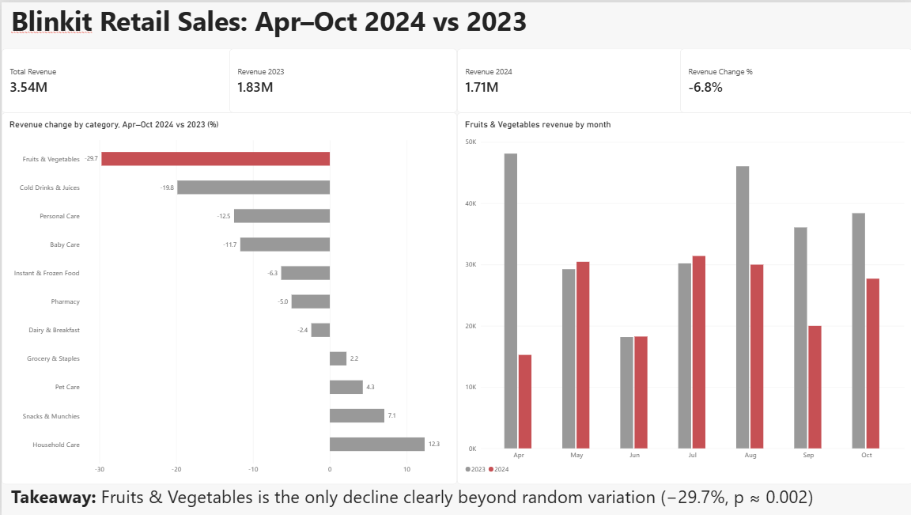
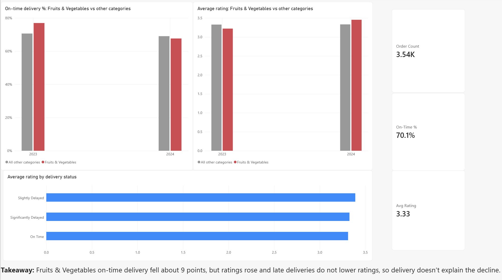

# Blinkit Retail Sales Analysis

Which product categories drove the 6.8% revenue decline between Apr–Oct 2023 and Apr–Oct 2024, and can delivery performance, customer ratings or stock damage explain it? An end-to-end analysis using PostgreSQL, Python and Power BI.



## Problem statement

Revenue in Apr–Oct 2024 fell about 6.8% against Apr–Oct 2023. Which product categories drove the decline, can delivery performance, customer ratings or stock damage explain it, and which categories should the business investigate first?

**Scope:** Apr–Oct 2023 vs Apr–Oct 2024 (the partial months, Mar 2023 and Nov 2024, are excluded). Revenue = quantity × unit price, because `order_total` does not reconcile with the order items (4,999 of 5,000 orders differ).

## Key findings

- **Overall:** revenue fell from 1.83M to 1.71M (−6.8%), while orders fell only from 1,791 to 1,753 (−2.1%).
- **Fruits & Vegetables is the only category whose decline is clearly more than random variation:** −29.7% (permutation test, p ≈ 0.002). It holds up even after correcting for testing 11 categories (0.05 ÷ 11 ≈ 0.0045).
- **Other declines are directional, not confirmed.** With 120–220 orders per category-year, changes such as Cold Drinks (−19.8%) could easily be random variation (p ≈ 0.19).
- **The Fruits & Vegetables drop is not spread evenly.** May–July were flat; the fall is concentrated in April and Aug–Oct. Excluding April 2023 (an unusually strong month), the decline is still about −20%.
- **What changed in Fruits & Vegetables:** fewer orders (−11%), fewer units (−21%) and a lower average unit price (−9%).
- **Delivery does not explain it.** On-time delivery for Fruits & Vegetables fell from 77.0% to 67.6% (other categories: 70.6% → 69.0%), but its average rating rose from 3.22 to 3.45. Average rating is about 3.3 whether a delivery is on time, slightly late or significantly late. Both differences are borderline (p ≈ 0.05–0.07).
- **Stock damage does not explain it either.** Fruits & Vegetables damage rose 6.4 points, less than Household Care (+19.3 points, whose sales grew 12%) and Dairy (+11.9 points).

| Category | Revenue change | Chance it is just luck (p) |
|---|---|---|
| **Fruits & Vegetables** | **−29.7%** | **0.002** |
| Cold Drinks & Juices | −19.8% | 0.19 |
| Personal Care | −12.5% | 0.32 |
| Baby Care | −11.7% | 0.43 |
| Household Care | +12.3% | 0.47 |

**Recommendation:** the available data cannot identify the cause, so investigate stock availability, pricing and discounts, and supply for Fruits & Vegetables in April 2024 and Aug–Oct 2024.

## Dashboard

Two-page Power BI report (`powerbi/blinkit_dashboard.pbix`).




## Method

1. **SQL (PostgreSQL):** loaded 8 tables, validated them (duplicate checks, primary keys, orphan-key checks, null checks, revenue reconciliation) and compared categories year over year.
2. **Python (pandas, NumPy, matplotlib):** rebuilt the year-over-year comparison and tested each category with a **permutation test**: all order lines from both years were pooled and randomly reassigned to two groups of the original sizes 10,000 times, and the p-value is the share of shuffles that gave a change at least as large as the real one.
3. **Power BI:** built the dashboard from a flat table exported by SQL and the summary tables from Python.

## Data notes

- Source: [add the link to the dataset page here]. The raw files are not included in this repository.
- Used the daily `blinkit_inventory` file. `blinkit_inventoryNew` was left out because it repeats product-month rows and its values differ from the daily file.
- Personal columns (name, email, phone, address) were dropped from the customers table after loading.
- In the delivery table, some on-time orders still carry a delay reason, and the only reason recorded is "Traffic".

## Limitations

- Small sample: 120–220 orders per category-year, and 16–35 per month for a single category.
- Each order has exactly one item, and every store and delivery partner ID appears only once, so basket and store-level analysis is not possible.
- Many relationships in the data look random (for example, delivery delays do not change ratings), so it appears to be a sample dataset. These findings describe this dataset, not Blinkit's real business.
- Absolute stock damage rates (40–78%) are unrealistically high, so only changes between years are compared.

## Project structure

```
blinkit-retail-analysis/
├── sql/
│   ├── 01_create_tables.sql
│   ├── 02_post_load.sql
│   ├── 03_checks.sql
│   ├── 04_analysis.sql
│   └── 05_export.sql
├── notebooks/
│   └── 01_category_analysis.ipynb
├── powerbi/
│   └── blinkit_dashboard.pbix
├── data/processed/          (summary tables used by the dashboard)
├── images/                  (charts and dashboard screenshots)
├── requirements.txt
└── README.md
```

## How to reproduce

1. Download the dataset into `data/raw/` (not included).
2. Create a PostgreSQL database named `blinkit`, run `sql/01_create_tables.sql`, import each CSV into its table, then run `sql/02_post_load.sql`.
3. Run `sql/03_checks.sql` and `sql/04_analysis.sql`, then `sql/05_export.sql` and save the result as `data/processed/analysis_orders.csv`.
4. Install the requirements (`pip install -r requirements.txt`) and run `notebooks/01_category_analysis.ipynb` from the `notebooks` folder.
5. Open `powerbi/blinkit_dashboard.pbix` in Power BI Desktop. If it cannot find the data, update the file paths under **Transform data > Data source settings**.

## Author

Shreyash Gupta · [LinkedIn](add-your-link) · B.Tech Mechanical Engineering, SVNIT Surat
